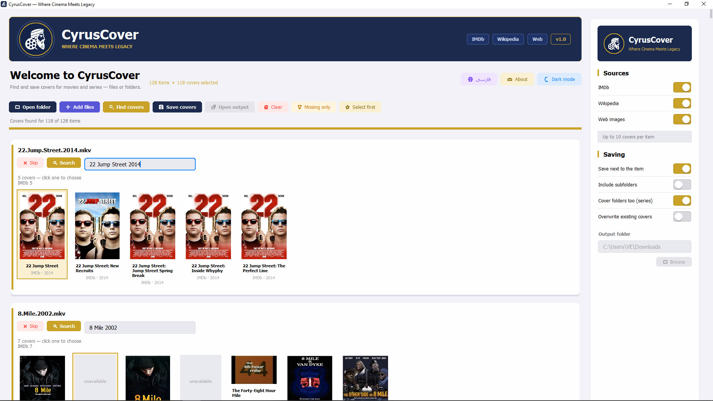

<div align="center">


# 🎬 CyrusCover

**Where Cinema Meets Legacy**

Find and save posters for your movies and TV series, directly from file or folder names.

[](#-download)
[](#-run-from-source)
[](https://github.com/myhadipour/CyrusCover/releases)
[](#-license)

[Download](#-download) · [Features](#-features) · [Screenshot](#-screenshot) · [Build](#-build-the-exe) · [فارسی](#-فارسی)

</div>

---

## 📸 Screenshot



## ✨ Features

- **Smart name parsing:** cleans names like `22.Jump.Street.2014.1080p.BluRay.mkv` into a clean title and year.
- **Multiple sources:** search **IMDb**, **Wikipedia**, and the **web** at the same time, with a choice of up to 10 posters per item.
- **Persian title support:** automatically translates Persian titles to English (via Wikipedia, Wikidata, and translation services) for better results.
- **Batch processing:** open a whole folder, search every item, and save all covers in one click.
- **Series support:** works with series folders, and can save covers inside each series folder.
- **Flexible saving:** save next to each file, or choose an output folder. Existing covers are kept unless you enable *Overwrite*.
- **Missing-only filter:** show only items that still have no cover.
- **Bilingual UI:** English and Persian (فارسی), with right-to-left layout.
- **Light and dark themes.**
- **Portable:** a single `.exe`, no installation or Python needed.

## 🚀 Download

Download the latest `CyrusCover.exe` from the [**Releases**](https://github.com/myhadipour/CyrusCover/releases) page, or from the [`exe/`](exe/) folder in this repository.

Requirements: Windows 10 or 11. No extra software needed.

## 🧭 How to use

1. Click **Open folder** (or **Add files**) and select your movies or series folder.
2. Click **Find covers**. The app searches every item and shows poster options.
3. Click the poster you want for each item (or click **Select first** to pick the top result for all items).
4. Choose where to save in the **Saving** panel.
5. Click **Save covers**.

Tip: if a search finds nothing, edit the title in the box and press **Search** again.

## 💻 Run from source

```bash
git clone https://github.com/myhadipour/CyrusCover.git
cd CyrusCover
pip install -r requirements.txt
python CyrusCover.pyw
```

## 🔨 Build the exe

On Windows, run `build.bat`. The executable is created at `exe\CyrusCover.exe`.

The script installs the requirements and uses PyInstaller to build a single-file, windowed app with the icon from `assets/cyruscover.ico`.

## 🗂️ Project structure

```
CyrusCover/
├── CyrusCover.pyw         Main application
├── assets/
│   ├── cyruscover.ico     App icon
│   ├── CineCyrus_Cover.jpg  Screenshot
│   └── Logo.png           Logo
├── exe/
│   └── CyrusCover.exe     Ready-to-run Windows build
├── build.bat              Builds the exe (Windows)
├── requirements.txt       Python dependencies
└── README.md
```

## 🛠️ Built with

- Python 3 and Tkinter (custom-drawn UI)
- Pillow (image processing, optional)
- ddgs (web image search)
- IMDb, Wikipedia, and Wikidata public endpoints

## 👤 Author

**Hossein Hadipour**
🌐 [myhadipour.ir](https://myhadipour.ir) · ✉️ myhadipour@gmail.com

## 📄 License

Released under the MIT License. See `LICENSE` for details.

---

<div dir="rtl" align="right">

# 🎬 فارسی

## CyrusCover

**جایی که سینما به میراث می‌رسد**

ابزاری برای پیدا کردن و ذخیره کاور فیلم و سریال، مستقیماً از روی نام فایل یا پوشه.

### ✨ امکانات
- **تشخیص هوشمند نام فایل:** نام‌هایی مثل `22.Jump.Street.2014.1080p.BluRay.mkv` را به عنوان و سال درست تبدیل می‌کند.
- **چند منبع جستجو:** همزمان در **IMDb**، **ویکی‌پدیا** و **تصاویر وب** جستجو می‌کند و تا ۱۰ گزینه برای هر فیلم نشان می‌دهد.
- **پشتیبانی از عنوان فارسی:** عنوان فارسی را به انگلیسی ترجمه می‌کند تا نتیجه‌ی بهتری بگیرد.
- **پردازش دسته‌ای:** یک پوشه‌ی کامل را باز کنید و کاور همه‌ی فیلم‌ها را با یک کلیک ذخیره کنید.
- **پشتیبانی از سریال:** پوشه‌های سریال را می‌شناسد و کاور را داخل همان پوشه ذخیره می‌کند.
- **ذخیره‌ی انعطاف‌پذیر:** کاور کنار فایل اصلی یا در پوشه‌ی دلخواه. کاورهای موجود بدون اجازه‌ی شما بازنویسی نمی‌شوند.
- **فیلتر بدون کاور:** فقط موردهایی را نشان می‌دهد که هنوز کاور ندارند.
- **رابط دوزبانه:** فارسی و انگلیسی، با چیدمان راست‌به‌چپ برای فارسی.
- **حالت روشن و تاریک.**
- **بدون نصب:** یک فایل `.exe`، بدون نیاز به پایتون.

### 🚀 دریافت برنامه
آخرین نسخه‌ی `CyrusCover.exe` را از بخش [**Releases**](https://github.com/myhadipour/CyrusCover/releases) دانلود کنید.
نیاز سیستم: ویندوز ۱۰ یا ۱۱.

### 🧭 نحوه‌ی استفاده
1. دکمه‌ی **Open folder** (یا **Add files**) را بزنید و پوشه‌ی فیلم‌ها یا سریال‌ها را انتخاب کنید.
2. روی **Find covers** بزنید تا برنامه همه‌ی موردها را جستجو کند.
3. برای هر مورد، کاور مورد نظرتان را انتخاب کنید (یا **Select first** را بزنید تا اولین نتیجه برای همه انتخاب شود).
4. محل ذخیره را در بخش **Saving** مشخص کنید.
5. روی **Save covers** بزنید.

### 💻 اجرا از سورس
```bash
git clone https://github.com/myhadipour/CyrusCover.git
cd CyrusCover
pip install -r requirements.txt
python CyrusCover.pyw
```

### 🔨 ساخت فایل اجرایی
در ویندوز، فایل `build.bat` را اجرا کنید. خروجی در `exe\CyrusCover.exe` ساخته می‌شود.

### 👤 سازنده
**حسین هادی‌پور**
🌐 [myhadipour.ir](https://myhadipour.ir) · ✉️ myhadipour@gmail.com

</div>
